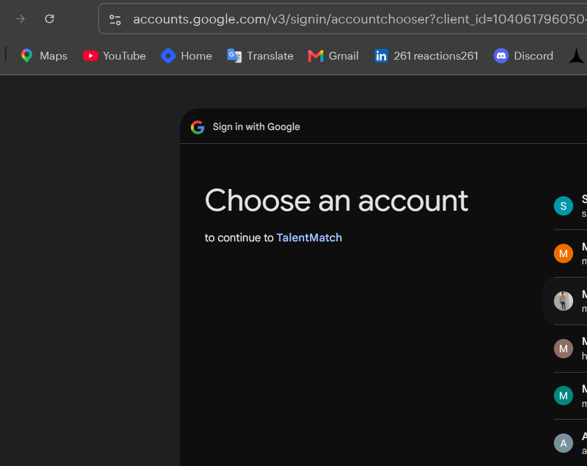
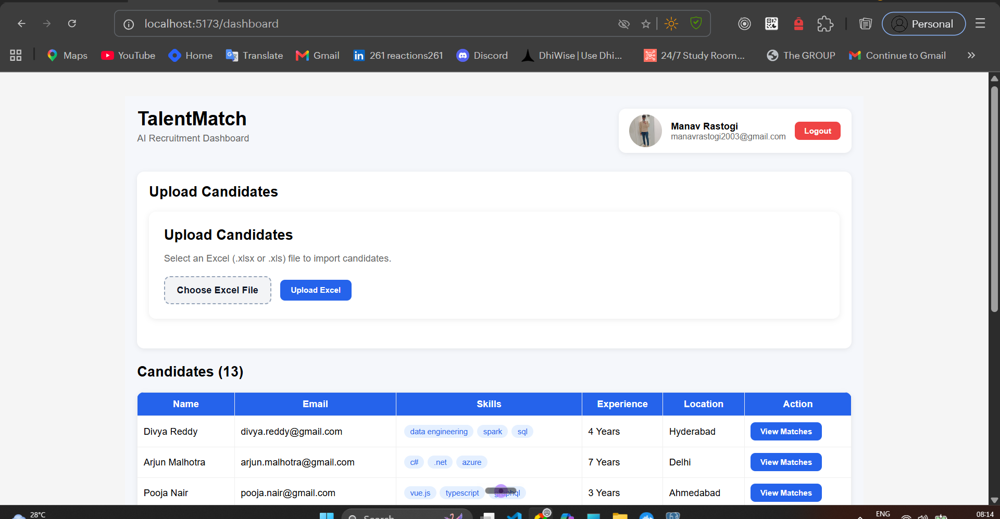
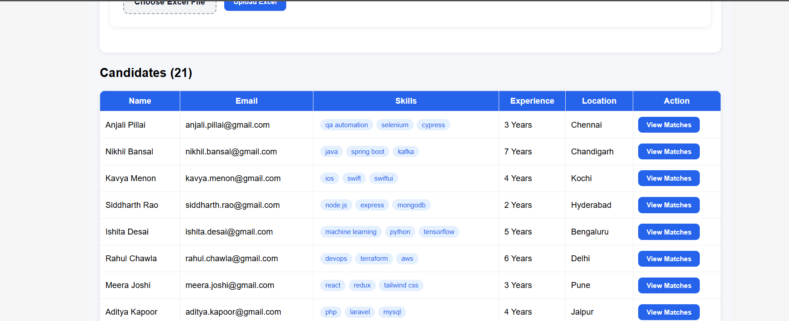
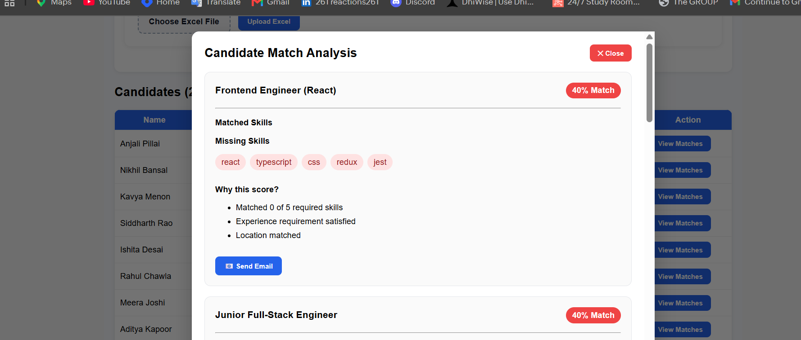
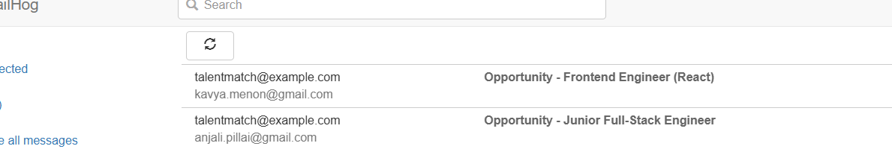
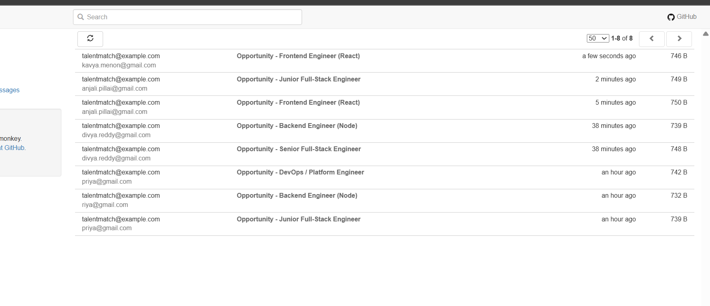
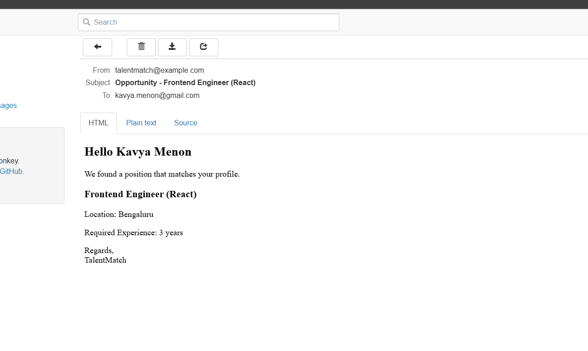

# WTF Tech Team — Full-Stack Engineer Take-Home

**Product to build: "TalentMatch" — a recruiting intelligence engine.**

Ingest candidate data at scale → enrich it → score candidates against open
positions → run automated, personalized email follow-ups — all behind Google
sign-in.

> ### Read this box before anything else
> What is specified below is a multi-day product. **We do not expect you to
> finish it.** You get **one focused ~2–3 hour coding window.** In that window
> build a **working vertical slice** of the highest-value path and **document
> the rest**. This spec is deliberately over-scoped. We are measuring
> **judgment, prioritization, engineering rigor, and UI/UX taste under real
> constraints** — not raw output. A small, correct, well-built, well-explained
> slice beats a large broken one **every single time.**

> **Start here:** a runnable scaffold is already in the repo — `docker compose up`
> boots Postgres + Mailhog + a Node/TS backend + a React shell. It saves you the
> boilerplate; **no features are implemented** (that's your job). See
> [`STARTER.md`](./STARTER.md).

---

## ▶ Running TalentMatch (submission setup)

> This section is the candidate-authored run guide. Design notes and the
> built/skipped/next breakdown live in [`PLAN.md`](./PLAN.md) and
> [`ARCHITECTURE.md`](./ARCHITECTURE.md).

### Prerequisites
- **Docker Desktop** (the one-command path), or Node 20 + a local Postgres 16 for the manual path.
- A **Google OAuth 2.0 Client** (free — steps below). Sign-in is real; there is no mock auth.

### 1. Configure environment
```bash
cp .env.example .env
```
Then open `.env` and fill in `GOOGLE_CLIENT_ID` / `GOOGLE_CLIENT_SECRET` from the OAuth
step below. Every other value already has a working local default.

### 2. Set up Google OAuth 2.0 (required for login)
1. Go to the [Google Cloud Console → Credentials](https://console.cloud.google.com/apis/credentials).
2. Pick or create a project (top bar).
3. **Configure the OAuth consent screen** (left nav → *OAuth consent screen*):
   - User type: **External**; fill in app name + your email; **Save and continue**.
   - Add your own Google account under **Test users** (while the app is unpublished only test users can sign in).
4. **Create credentials → OAuth client ID**:
   - Application type: **Web application**.
   - **Authorized JavaScript origins:**
     - `http://localhost:5173`
     - `http://localhost:8080`
   - **Authorized redirect URI** (must match exactly):
     - `http://localhost:8080/auth/google/callback`
5. Click **Create**, copy the **Client ID** and **Client secret** into `.env`:
   ```env
   GOOGLE_CLIENT_ID=your-client-id.apps.googleusercontent.com
   GOOGLE_CLIENT_SECRET=your-client-secret
   GOOGLE_CALLBACK_URL=http://localhost:8080/auth/google/callback
   ```
   The `GOOGLE_CALLBACK_URL` and the Authorized redirect URI **must be identical** — a
   mismatch is the #1 cause of `redirect_uri_mismatch` at sign-in.

### 3. Start the stack
```bash
docker compose up            # Postgres + Mailhog + backend (:8080) + frontend (:5173)
```
In a second terminal, create the schema and load the open positions:
```bash
docker compose exec backend npm run migrate   # applies migrations 001–006
docker compose exec backend npm run seed       # loads sample-data/positions.json
```
> Manual (no Docker): run `npm install` in `backend/` and `frontend/`, start a local
> Postgres, point `DATABASE_URL` at it, then `npm run migrate && npm run seed && npm run dev`
> in `backend/` and `npm run dev` in `frontend/`.

### 4. Open the app
| URL | What |
|-----|------|
| http://localhost:5173 | Frontend (redirects to `/login` until signed in) |
| http://localhost:8080/health | API health + DB connectivity |
| http://localhost:8025 | Mailhog — every outbound email lands here |

### Environment variables
| Var | Purpose | Local default |
|-----|---------|---------------|
| `GOOGLE_CLIENT_ID` / `GOOGLE_CLIENT_SECRET` | Google OAuth client | *(you provide)* |
| `GOOGLE_CALLBACK_URL` | OAuth redirect target | `http://localhost:8080/auth/google/callback` |
| `SESSION_SECRET` | Signs the session cookie | `dev-secret-change-me` |
| `DATABASE_URL` | Postgres connection | in-compose: `…@postgres:5432`; host psql: port **5433** |
| `SMTP_HOST` / `SMTP_PORT` | Mailhog SMTP | `mailhog` / `1025` (host: `localhost` / `1025`) |
| `FRONTEND_URL` | CORS origin + post-login redirect | `http://localhost:5173` |
| `VITE_API_URL` | Frontend → API base URL | `http://localhost:8080` |
| `PORT` | Backend port | `8080` |

> Note: Docker maps Postgres to host port **5433** (`5433:5432`) to avoid clashing with a
> local Postgres. Inside the compose network the backend still reaches it on `5432`.

### Routes
`/login` · `/` (dashboard) · `/upload` · `/candidates` · `/candidates/:id` ·
`/positions` · `/positions/:id`. All routes except `/login` require an authenticated
session; the API mirrors this and returns **401** on protected endpoints without one.

---

## Table of contents
1. [The scenario](#1-the-scenario)
2. [Feature specs (detailed)](#2-feature-specs)
3. [Frontend & UI spec](#3-frontend--ui-spec)
4. [Backend & engineering spec](#4-backend--engineering-spec)
5. [Data model](#5-data-model)
6. [Tech constraints](#6-tech-constraints)
7. [Performance targets](#7-performance-targets)
8. [Grading rubric](#8-grading-rubric)
9. [Ground rules — no AI, solo](#9-ground-rules)
10. [Suggested time budget](#10-suggested-time-budget)
11. [What to submit](#11-what-to-submit)
12. [Provided assets](#12-provided-assets)
13. [FAQ](#13-faq)

---

## 1. The scenario

WTF's recruiting team is drowning. Candidate data arrives as **hundreds of
thousands of rows spread across many Excel files** (job-board exports, referral
sheets, event sign-ups). Today a human opens each file, eyeballs it, guesses who
fits which open role, and manually emails people. It does not scale.

You are building the engine that replaces that manual work. Five capabilities,
listed in **priority order** — build top-down, and stop-and-document when time
runs out.

---

## 2. Feature specs

Each feature below has **Functional requirements**, **Acceptance criteria** (how
we verify it works), and **Edge cases** (which we will actively test). Treat the
acceptance criteria as your definition of done for that slice.

### 2.1 — Google authentication  *(the gate — do this first, ~30 min)*

**Functional requirements**
- Sign in with **Google OAuth 2.0** (Authorization Code flow). No mock/fake auth.
- Every page except the login screen is **protected**. Unauthenticated requests
  to the API return **401**; the SPA redirects to `/login`.
- Session persists across a **full page refresh** and browser restart
  (httpOnly cookie session or JWT + refresh — your call, justify it).
- A visible **signed-in user** (avatar + name + email) with a working **Sign
  out**.

**Acceptance criteria**
- [ ] Fresh browser → hitting any protected route redirects to login.
- [ ] Completing Google sign-in lands on the dashboard with my Google name/photo.
- [ ] Refreshing the page keeps me signed in.
- [ ] Hitting an API route with no/invalid session returns `401`, not a crash.
- [ ] Sign out clears the session; protected routes are unreachable again.

**Edge cases we test:** cancelling the Google consent screen; an expired/tampered
session cookie; two tabs open, sign out in one.

---

### 2.2 — Bulk Excel ingestion at scale  *(THE core challenge — spend the most time here)*

**Functional requirements**
- Upload **one or many `.xlsx` files** via the UI. Individually large; **the
  system as a whole must handle 100,000s of rows** without OOM or UI freeze.
- **Non-blocking pipeline.** The HTTP upload returns quickly with a **job id**;
  parsing/inserting happens in the **background**. The UI **polls or streams
  progress** (rows processed / total, % done, live status).
- **Streaming parse.** You may **not** load the whole workbook into memory as one
  array and `INSERT` it. Stream rows, insert in **batches** (e.g. 500–5,000).
- **Flexible header mapping.** Column headers vary across files. Map common
  variants to a canonical schema:
  - name ← `name`, `full name`, `candidate`, `first`+`last`
  - email ← `email`, `e-mail`, `email address`, `mail`
  - phone ← `phone`, `mobile`, `contact`, `phone number`
  - skills ← `skills`, `tech`, `stack`, `expertise`
  - experience ← `experience`, `years`, `yoe`, `exp`
  - location ← `location`, `city`, `based in`, `region`
  - Unknown columns: keep in a `raw` JSONB blob, don't drop silently.
- **Deduplication.** The same human appears across files. Dedup on
  **normalized email** first; if email missing, fall back to
  `normalized(name) + phone`. One human = one candidate row; **merge** new
  non-null fields into the existing record (don't blindly overwrite good data
  with blanks).
- **Resilient to bad rows.** Blank rows, missing emails, malformed cells,
  wrong types — a few bad rows **must not** kill a 200k-row job. Collect them.
- **Job report.** When done, show **rows read / inserted / merged (dupes) /
  failed**, plus a downloadable or viewable **list of failed rows with reasons**.

**Acceptance criteria**
- [ ] Uploading `candidates-sample.xlsx` ingests it and shows a job summary.
- [ ] Uploading a **100k-row** generated file completes without OOM; the UI shows
      moving progress the whole time and never blocks.
- [ ] Uploading the **same file twice** results in **0 new** candidates the second
      time (all merged as dupes), not 2× rows.
- [ ] A file with 50 deliberately-broken rows still ingests the good rows and
      reports the 50 with reasons.
- [ ] Server memory stays bounded during a large ingest (no linear blow-up).

**Edge cases we test:** duplicate emails within one file; same person with
different casing/whitespace in email; a row with skills but no email; a 100k file
where row 40,000 is garbage; two uploads running at once.

---

### 2.3 — Data enrichment

**Functional requirements** — produce a derived, queryable profile per candidate:
- Normalize `email` (lowercase, trim), `name` (trim, title-case), `phone` (strip
  formatting to digits).
- Parse `skills` free-text into a **structured, de-duplicated list**
  (`"React, node.js; Postgres"` → `["react","node.js","postgres"]`).
- Derive `years_of_experience` (int) from messy input (`"5+ yrs"`, `"3 years"`).
- Infer `seniority` from experience via documented thresholds
  (e.g. `<2 = junior`, `2–5 = mid`, `5+ = senior`).
- Standardize `location` to a consistent form you define.
- Enrichment is **rule-based and deterministic**. **No paid enrichment APIs, no
  AI/LLM.** The determinism is the point.

**Acceptance criteria**
- [ ] Given messy input, the stored profile has clean, structured fields.
- [ ] The same input always yields the same enriched output (deterministic).
- [ ] Skills are queryable (a candidate can be found by a skill).

**Edge cases we test:** empty skills; experience as a word (`"fresher"`);
non-numeric experience; unicode in names.

---

### 2.4 — Candidate → position matching

**Functional requirements**
- A set of **open positions** is provided in `/sample-data/positions.json`
  (title, `required_skills[]`, `min_experience`, `location`, `remote`).
- For **each position**, return a **ranked list of best-fit candidates** with:
  - a **numeric match score** (define your own 0–100 scale),
  - a short, human-readable **"why"** string
    (e.g. *"5/6 required skills · 4 yrs vs 3 required · same city"*).
- Scoring must be **explainable and deterministic** — no black box. Document the
  formula (skill overlap, experience gap, location/remote fit, etc.) in
  `ARCHITECTURE.md`.
- Sensible defaults: skill overlap dominates; experience below the minimum
  penalizes; location/remote is a modifier.

**Acceptance criteria**
- [ ] Opening a position shows candidates ranked high → low by score.
- [ ] Each row shows the score and a truthful "why" that matches the data.
- [ ] Changing a candidate's skills changes their rank (recomputable).

**Edge cases we test:** a position with a rare skill (few matches); a candidate
matching many positions; ties broken deterministically.

---

### 2.5 — Automated bulk email follow-ups

**Functional requirements**
- From a position's shortlist, trigger a **bulk, personalized, templated email**
  to the top **N** candidates.
- Template supports variables: `{{first_name}}`, `{{position}}`, `{{top_skill}}`
  — e.g. *"Hi {{first_name}}, your background in {{top_skill}} is a strong fit
  for our {{position}} role…"*.
- Sending is **queued and stateful**: each recipient row is
  `queued → sending → sent | failed`, with a timestamp and error reason on
  failure. Failures are **retryable** without re-sending the successes.
- **Idempotent.** A candidate is **never double-emailed for the same position**.
  Re-running the send skips already-sent recipients.
- **No real inbox required.** Use a **dev SMTP** (Mailhog / Ethereal) or a logged
  **`outbox` table**. We grade the **pipeline, queue, state machine, and
  idempotency** — not deliverability.

**Acceptance criteria**
- [ ] Triggering a send enqueues N recipients and their statuses move to `sent`.
- [ ] Re-triggering the same position send emails **0** already-sent candidates.
- [ ] A forced failure marks that recipient `failed` with a reason; a retry sends
      only the failed ones.
- [ ] Each sent email is personalized (name/skill/position correct).

**Edge cases we test:** double-click the send button (no double send); send to a
candidate with a missing first name (graceful fallback); retry after partial
failure.

---

## 3. Frontend & UI spec

We care about **UI/UX taste**, not pixel-perfection. Build a clean, legible,
**responsive** dashboard. Any component approach is fine (your own CSS, Tailwind,
MUI, shadcn, etc.) — **consistency and clarity** are what we score.

**Screens / routes (minimum):**

| Route | Purpose | Must include |
|-------|---------|--------------|
| `/login` | Google sign-in | "Sign in with Google" button; nothing else accessible |
| `/` dashboard | At-a-glance | total candidates, # positions, last ingest summary, nav |
| `/upload` | Ingest files | drag-and-drop / file picker (multi-file), **live progress**, post-job summary + failed-rows view |
| `/candidates` | Browse candidates | **paginated / virtualized** table (do **not** render 100k rows at once), search by name/email, **filter by skill**, sort; row → detail |
| `/candidates/:id` | Candidate detail | enriched profile, raw fields, positions they match |
| `/positions` | Positions list | each position with match count |
| `/positions/:id` | Ranked shortlist | ranked candidates + score + "why"; **"Email top N"** action with a confirm; per-recipient send status |

**Component-state discipline (we look for all four on data views):**
- **Loading** — skeletons/spinners, never a blank flash.
- **Empty** — a helpful empty state ("No candidates yet — upload a file").
- **Error** — a real error message + retry, never a white screen.
- **Success** — the actual data.

**Specific UI expectations:**
- The candidates table **must not** DOM-render 100k rows — use **server-side
  pagination** and/or **virtualization**. This is an explicit test of scale
  awareness on the front end too.
- Upload progress must be **live and truthful** (bytes/rows/percent), and the UI
  must stay interactive during a large ingest.
- Actions that cost money/annoy humans (bulk email) require a **confirmation**
  and show a **result summary** (X sent, Y failed, Z skipped).
- Forms and buttons have **disabled/pending** states; no double-submits.
- Reasonable **accessibility**: labelled inputs, keyboard-focusable controls,
  sufficient contrast.
- **Responsive** down to a narrow laptop width; it should not break at 1280px.

**What we do NOT require:** a design system, animations, dark mode, mobile-first,
or brand theming. Clean and functional wins.

---

## 4. Backend & engineering spec

**Architecture expectations**
- Clear separation: **HTTP layer → service/domain layer → data layer**. No
  business logic inside route handlers or React components.
- **Config via env vars** (documented in `.env.example`). No secrets committed.
- **Migrations**, not hand-run SQL. A **seed script** that loads
  `positions.json`.
- **Background processing** for ingestion (a queue, a worker, `worker_threads`,
  or at minimum a decoupled async job with a persisted job record — justify it).
- **Idempotency** where it matters (dedup on ingest; no double-email on send).
- **Validation** at the API boundary (reject bad payloads with 4xx + message).
- **Errors** are handled and logged; the server never dies on one bad row/request.

**API — suggested surface (adapt as you like, document what you build):**

```
POST   /auth/google            → begin OAuth
GET    /auth/google/callback   → complete OAuth, set session
POST   /auth/logout
GET    /me                     → current user (401 if not signed in)

POST   /uploads                → accept file(s), create job, return { jobId }   (202)
GET    /uploads/:jobId         → { status, total, processed, inserted, merged, failed }
GET    /uploads/:jobId/failures→ list of failed rows + reasons

GET    /candidates?query=&skill=&page=&pageSize=&sort=   → paginated
GET    /candidates/:id

GET    /positions
GET    /positions/:id/matches?limit=   → ranked candidates + score + reason

POST   /positions/:id/emails   → enqueue send to top N { limit } (idempotent)
GET    /positions/:id/emails   → per-recipient send status
```

**Testing:** we don't need 100% coverage in 3 hours. We **do** want to see tests
on the **highest-risk logic** — header mapping, dedup/merge, the match scorer,
and email idempotency. A few sharp unit tests > a broad shallow suite.

---

## 5. Data model

You own the schema; migrations required. A reasonable shape (illustrative — build
what your design needs):

```sql
users(id, google_id, email, name, avatar_url, created_at)

candidates(
  id, email UNIQUE, name, phone,
  skills TEXT[],                 -- structured, enriched
  years_of_experience INT,
  seniority TEXT,                -- junior|mid|senior
  location TEXT,
  raw JSONB,                     -- original + unmapped columns
  source_file TEXT,
  created_at, updated_at
)                                -- INDEX on email; consider GIN on skills

positions(id, title, required_skills TEXT[], min_experience INT, location TEXT, remote BOOL)

ingest_jobs(id, filename, status, total_rows, processed_rows,
            inserted, merged, failed, error, created_at, finished_at)

ingest_failures(id, job_id FK, row_number, raw JSONB, reason)

email_sends(
  id, position_id FK, candidate_id FK,
  status TEXT,                   -- queued|sending|sent|failed
  error TEXT, sent_at,
  UNIQUE(position_id, candidate_id)   -- ← this enforces idempotency
)
```

Call out your **indexes** and **why** in `ARCHITECTURE.md` — at 100k+ rows,
missing indexes on `email`/skill lookups is a red flag.

---

## 6. Tech constraints (non-negotiable)

| Layer     | Requirement |
|-----------|-------------|
| Backend   | **Node.js** (TypeScript strongly preferred & rewarded) |
| Frontend  | **React** |
| Database  | **PostgreSQL** — real schema, real migrations, real indexes |
| Auth      | **Google OAuth 2.0** (real) |
| Run       | **One command** — `docker compose up`, or a documented `npm` script + `.env.example`. **If we can't run it, we can't score it.** |

Everything else (framework, ORM, queue, UI kit) is your choice — **justify each
in `ARCHITECTURE.md`.**

---

## 7. Performance targets

Targets to design toward (not hard pass/fail, but we'll observe):

- **Ingestion:** 100k rows completes in a **sane** wall-clock time on a laptop
  (single-digit minutes), with **bounded memory** (no OOM, no loading the whole
  file into one array).
- **Candidates list API:** **p95 < 300 ms** on a 100k-row table with pagination +
  the right indexes.
- **UI:** stays interactive during a large ingest; the candidates table renders
  smoothly without DOM-ing all rows.
- **Match query:** returns a position's ranked shortlist in **< 1 s**.

If you don't hit these, **say so in `ARCHITECTURE.md` and explain how you'd get
there.** Naming the fix earns most of the credit.

---

## 8. Grading rubric

We grade the **thinking**, not the checklist (100 pts):

| Area | Pts | What we look for |
|------|-----|------------------|
| **Prioritization & scope** | **20** | Built the *right* slice first; defensible cut line |
| **Scale & performance** | **20** | Ingestion realistically survives 100k+; streaming/batching/indexing; paginated/virtualized UI |
| **Architecture & data model** | **15** | Clean layers, sane schema, migrations, idempotency |
| **Code quality** | **15** | Readable, typed, tested where it matters, no dead/AI-slop code |
| **Correctness of the slice** | **15** | What you built actually works end-to-end |
| **Frontend & UX** | **10** | Clear, consistent, all four states (loading/empty/error/success), scale-aware table |
| **Docs & tradeoffs** | **5** | `ARCHITECTURE.md` explains built vs. skipped vs. next, and scaling plan |

> **Explicit:** finishing all 5 features is **not** how you win. Rock-solid Google
> auth + streaming ingestion of 200k rows with dedup, a paginated candidates UI,
> and a clear write-up of the remaining features **outscores** a half-built all-five.

---

## 9. Ground rules

This is an **individual, unassisted** test. We want to see **how *you* think.**

- **No AI assistants.** No Copilot, Cursor, ChatGPT/Claude, Gemini, or any
  code-gen. Turn them off for the duration.
- **How we verify:**
  - We read your **git history** — commit **little and often** so we see the
    build evolve. One giant "final commit" is a flag.
  - We run a **live follow-up**: you **share your screen, walk us through your
    code, and extend it on the spot**. **If you can't explain or modify your own
    code, that's an automatic fail** — this is the real anti-AI check.
  - We look for generated-code fingerprints: uniform over-commenting, unused
    scaffolding, inconsistent style, libraries you can't justify.
- Public libraries and official docs are fine. Copying a whole solution is not.
- **When time runs out, stop and document.** *"I'd put a Redis queue here, here's
  the schema and the failure handling I'd add"* earns real points. Faking
  completion earns none.

---

## 10. Suggested time budget (~2–3 focused hours)

Guidance, not a rule:

| Time | Do |
|------|----|
| ~15 min | Read this. Write `PLAN.md`: your schema sketch + your cut line. |
| ~30 min | Google OAuth + protected routes + `/me`. |
| ~75 min | **The ingestion pipeline** — streaming `.xlsx` → header map → batched insert → dedup/merge → live progress + job report. **Most of your time goes here.** |
| ~30 min | A thin slice of matching (one position, ranked) + **one** working dev email send with idempotency. |
| ~15 min | `ARCHITECTURE.md`: built / cut / next + scaling plan. Final commits. |

---

## 11. What to submit

Push to a **private** repo and add the reviewer(s) as collaborators (we'll give
you handles), or open a PR to a branch we prepare. Submission must include:

- [ ] Working code, runnable with **one documented command**.
- [ ] `README.md` — run steps, env vars, **Google OAuth setup** (how to get
      client id/secret, redirect URIs).
- [ ] `ARCHITECTURE.md` — decisions, **built vs. skipped**, tradeoffs, and **how
      you'd scale each piece to millions of rows**.
- [ ] `PLAN.md` — your initial scoping / cut-line notes (write this **first**).
- [ ] Database **migrations** + a **seed script** (loads `positions.json`).
- [ ] A `.env.example`.
- [ ] Tests on the **high-risk logic** (mapping, dedup, scoring, email idempotency).
- [ ] A ≤3-min **Loom/GIF** demoing what works (optional, strongly encouraged).
- [ ] **Honest git history** — many small commits.

---

## 12. Provided assets

In [`/sample-data`](./sample-data):

- **`positions.json`** — the open roles to match against (seed this).
- **`generate-candidates.js`** — a Node script that generates a **deliberately
  messy** dataset: inconsistent headers, duplicates, blank rows, malformed cells.
  Run it small to build against, and large to test scale:
  ```bash
  cd sample-data
  npm i xlsx
  node generate-candidates.js 500        # candidates-sample.xlsx (messy, small)
  node generate-candidates.js 100000      # candidates-large.xlsx  (scale test)
  ```
  **Do not commit the large file.**
- **`README.md`** (in that folder) — describes the mess we intentionally baked in.

---

## 13. FAQ

**Q: This is way more than a couple of hours of work.**
Correct — on purpose. Re-read the top box and §8. We test prioritization. Build
the best small thing; document the rest.

**Q: Can I mock the emails and the candidate data?**
Mock **email delivery** (dev SMTP / outbox) — yes. Google **auth must be real**.
Candidate data is generated by the provided script — no real inboxes needed.

**Q: Do the columns really vary between files?**
Yes. Header mapping/normalization is core. Handle the common variants; document
what you didn't.

**Q: TypeScript or JavaScript?**
Either runs; **TypeScript is strongly preferred** and rewarded under Code quality.

**Q: Can I use an ORM / queue / UI kit / framework?**
Your call — just **justify it** in `ARCHITECTURE.md`.

**Q: What matters most if I can only do one thing well?**
**§2.2 — ingestion at scale.** A bulletproof streaming ingest with dedup and live
progress is the single strongest signal you can send.

---

**Good luck. Show us how you think.** — WTF Tech Team






